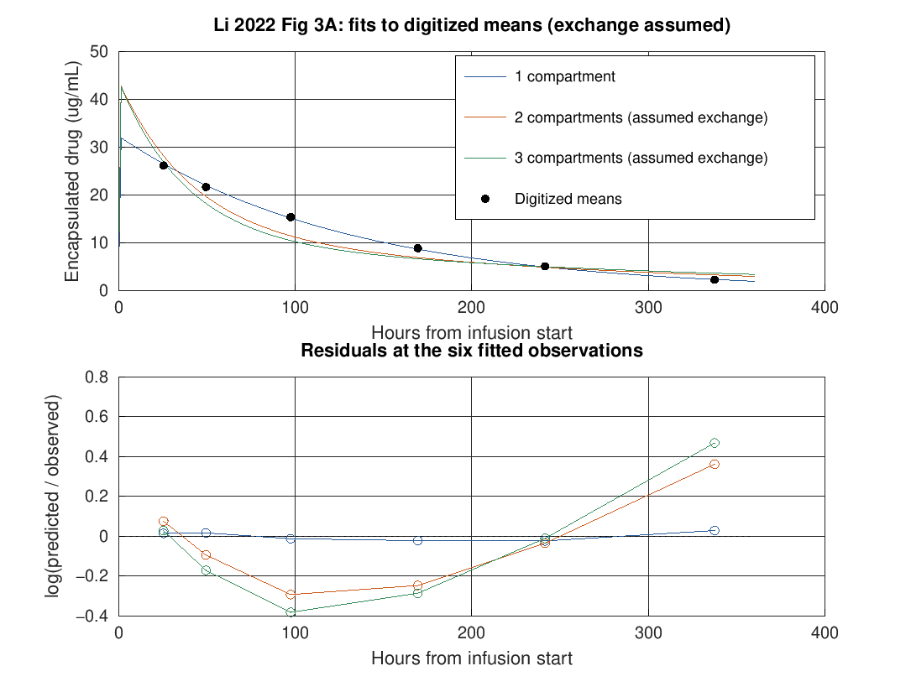

# Nanoparticle drug circulation

I built a nanoparticle drug circulation simulator because I wanted to understand how liposomal drug concentrations change over time. It divides the body into connected pools and compares their predicted concentrations with measurements read from a published graph. I can run the example below or change the dose and pool settings for my own exploration.

## Try the example

Install GNU Octave and a plotting backend. On Ubuntu:

```sh
sudo apt-get update
sudo apt-get install octave gnuplot-nox ghostscript fonts-freefont-otf
octave --no-gui --quiet scripts/run_tests.m
octave --no-gui --quiet scripts/regenerate_all.m
octave --no-gui --quiet scripts/check_results.m
```

Run these commands from this project folder. On macOS I use `brew install octave gnuplot`. The regeneration writes graphs to `figures/` and tables to `results/` without downloading data.

## A worked fit

I fitted clearance (the rate at which drug leaves the central pool) and central volume (the apparent size of that pool) to six rounded group means read from a published liposomal doxorubicin graph. For the one-pool model, the fitted clearance is about 0.0120 L/h/m² and the central volume is about 1.55 L/m². At 25.5 hours the observed concentration is 26.2 µg/mL and the prediction is 26.57 µg/mL, an error of +0.37 µg/mL. The [full table](results/fit_residuals.csv) lists every observation, prediction and error for each model.



The plot compares the fits and shows residuals, the differences between predictions and observations. These are in-sample comparisons, not independent predictions. The data are approximate group means, not individual patient measurements; only six rounded points were read, and the exchange parameters in the multi-pool models are assumed. These limits mean the fits cannot describe individual patients or establish clinical dosing. The [data notes](data/README.md) identify the paper and explain the digitization.

## Use different inputs

```matlab
addpath('src');
p = pk_parameters(2);       % two pools
p.dose = 50;               % mg
p.infusion = 1.5;          % hours; zero gives an immediate dose
p.V = [2, 1];              % litres
p.CL = 0.02;               % L/h
p.Q = 0.01;                % L/h between pools
s = pk_simulate(p, [0 1 2 24 48 96]);
plot(s.time, s.concentration);
xlabel('Time (h)'); ylabel('Concentration (mg/L)');
% Synthetic example observations:
f = pk_fit([2 24 48 96], [24 18 14 8], p, {'CL', 'V1'});
rows = pk_fit_residuals([2 24 48 96], [24 18 14 8], f)
```

`pk_parameters(1)`, `(2)` and `(3)` select one, two or three compartments. Units are mg, L and hours; mg/L and µg/mL have the same numerical value. The published example uses a dose per square metre of body surface area, so its fitted volumes and clearances use that same scaling. See [methods](docs/methods.md) for assumptions and equations.

## Implementation and checks

The MATLAB-language functions in `src/` use `ode45` to integrate the compartment equations and `fminsearch` to fit parameters. The regeneration script also calculates sensitivity, mass balance and simulated variability. The Octave tests cover analytical solutions, mass balance, parameter recovery and diagnostics; CI runs the suite, regenerates the outputs and checks the exported tables and figures.
