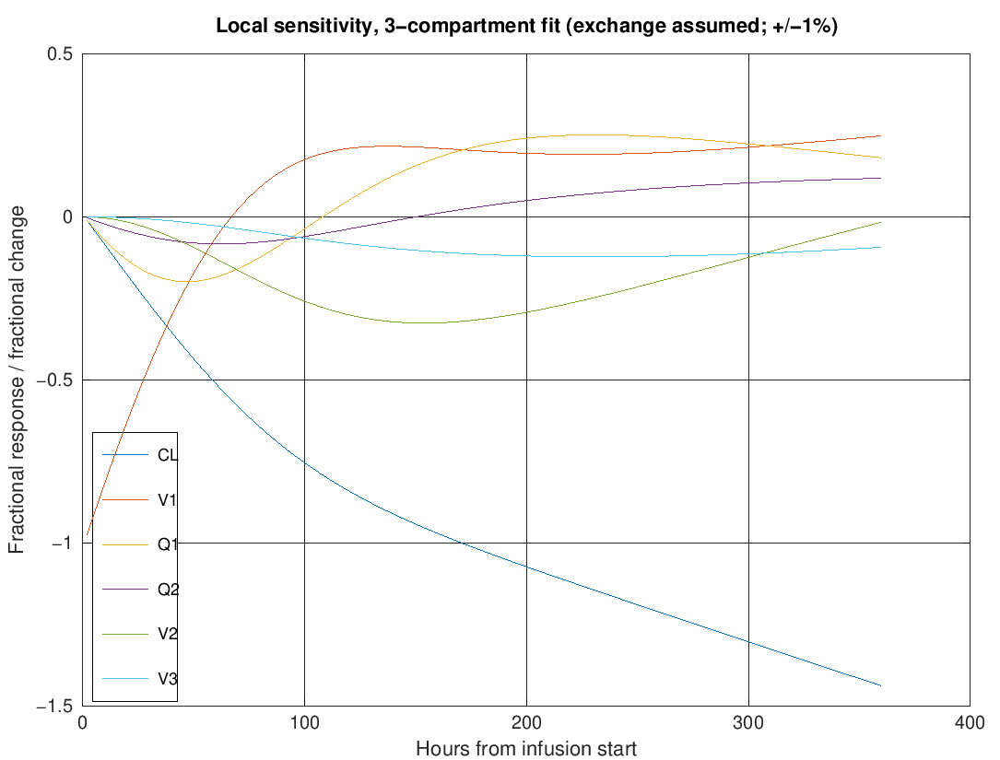
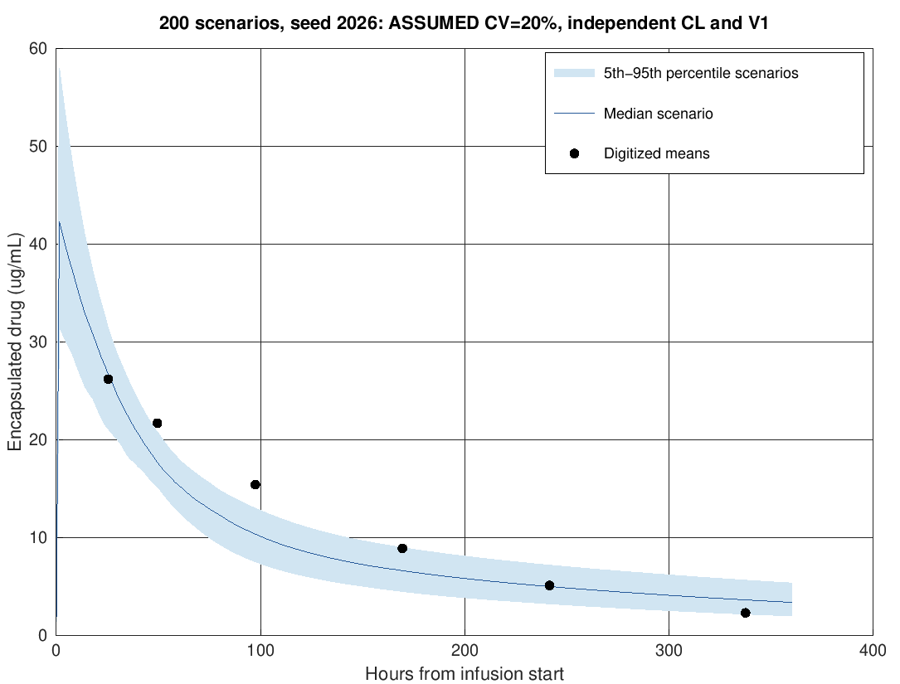
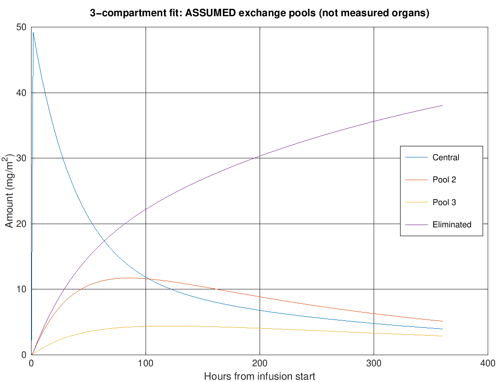

I built a nanoparticle drug circulation simulator because I wanted to understand how a drug carried inside tiny lipid particles could stay in the bloodstream, and how much a simple model could explain from a published graph.

I give the model a dose, let drug move between a few connected pools, and compare the predicted blood concentration with public measurements of liposomal doxorubicin. The toolkit fits the curve, shows which inputs change it most, and runs 200 possible scenarios to see how assumed differences in clearance and volume affect the result. A compartment is just a well-mixed pool; the extra pools are not measured organs.

To try it, install [GNU Octave](https://octave.org/download) and run these commands from the repository folder. The second command rebuilds every figure and result table:

```sh
octave --no-gui --quiet scripts/run_tests.m
octave --no-gui --quiet scripts/regenerate_all.m
```

I wrote the library in **MATLAB-language code and run it in GNU Octave**. No MathWorks licence is required or claimed. I have not run it in MathWorks MATLAB.


The dots are six approximate group means I read from [Li et al. (2022), Figure 3A](https://doi.org/10.3389/fonc.2022.1070001). They are published measurements read from a picture, not invented observations or individual patient records. The two- and three-pool curves fit clearance and central volume while holding exchange at assumed values. Those assumptions appear on the figures and in the [data notes](data/README.md).

## Running it on my own data

On Ubuntu, the complete installation is:

```sh
sudo apt-get update
sudo apt-get install octave gnuplot-nox ghostscript fonts-freefont-otf
octave --no-gui --quiet scripts/run_tests.m
octave --no-gui --quiet scripts/regenerate_all.m
octave --no-gui --quiet scripts/check_results.m
```

On macOS, I use `brew install octave gnuplot`. There are no extra Octave packages or paid toolboxes. Docker is another option: `docker build -t nanoparticle-pk .` followed by `docker run --rm nanoparticle-pk`. That runs tests and regeneration inside the container; its files disappear when it exits. To keep the output on my computer, I use `docker run --rm -v "$PWD/figures:/work/figures" -v "$PWD/results:/work/results" nanoparticle-pk`.

For a different experiment, I can call the functions directly in Octave:

```matlab
addpath('src');
p = pk_parameters(2);        % Two pools, initially assumed parameters
p.dose = 50;                 % mg
p.infusion = 1.5;            % hours; use 0 for an immediate bolus
p.V = [2, 1];                % litres, central first
p.CL = 0.02;                 % central clearance, L/h
p.Q = 0.01;                  % exchange clearance, L/h
s = pk_simulate(p, [0 1 2 24 48 96]);
plot(s.time, s.concentration);
xlabel('Time (h)'); ylabel('Concentration (mg/L)');

% These are synthetic example observations, not published measurements.
f = pk_fit([2 24 48 96], [24 18 14 8], p, {'CL', 'V1'});
a = pk_sensitivity(f.params, [2 24 48 96], {'CL', 'V1', 'Q1'});
m = pk_monte_carlo(f.params, [0 2 24 48 96], {'CL', 'V1'}, 0.2, 200, 2026);
```

`pk_parameters(1)`, `(2)` and `(3)` select one, two or three compartments. Units are mg, L and hours; mg/L has the same numerical value as µg/mL. For the published example, the dose is 50 mg/m², so the fitted volumes and clearances are interpreted per square metre of body surface area. I keep that scaling explicit instead of guessing a patient size.

## What the results mean

Clearance is how quickly the central pool loses drug, expressed as a volume cleared per hour. I fit clearance and central volume by least squares: the optimizer reduces squared differences between the logarithms of predicted and observed concentrations. This gives relative errors similar influence across a falling curve. The one-pool fit has an RMSE (typical concentration error) of about 0.245 µg/mL across these six rounded means. The fixed exchange assumptions in the larger models give visibly worse fits; more pools do not automatically explain the data better. All three models use `ode45`, an adaptive differential-equation solver, including the reported 90-minute infusion.

The six late observations do not reliably determine all the exchange rates. I keep those rates and peripheral volumes fixed in the published-data example. The library can fit a chosen subset of `CL`, `V1` through `V3`, and `Q1` through `Q2` when the data support it. I would need richer measurements before interpreting these pools as biology or choosing a model from its fit error.



Sensitivity measures the fractional change in concentration for a small fractional change in an input. This plot changes each input by plus or minus 1% around the three-compartment conditional fit.



Monte Carlo means repeating the simulation with randomly varied inputs. Here I assume independent, positive clearance and volume values with a 20% coefficient of variation, a measure of spread. The shaded range contains the middle 90% of 200 simulated scenarios. It is not a measured population range or a confidence interval. The seed makes the study repeatable.



I also track eliminated drug so that the total in the pools plus the amount eliminated equals the dose delivered. The extra pools use assumed exchange and do not predict tumour uptake.

This project is for learning and research exploration. It cannot select a treatment or predict an individual's response. The digitization, fixed exchange assumptions and missing free-drug measurements limit what I can conclude. [Methods and equations](docs/methods.md) explain the details.

## Library and reproducible outputs

Each function in `src/` has a help comment with its inputs, outputs and units. `scripts/regenerate_all.m` rebuilds all four figures and six CSV files in `results/`, including fitted parameters, concentration curves, sensitivity, every Monte Carlo draw, percentile curves and mass balance. Nothing downloads during a run.

I use Octave test blocks instead of `matlab.unittest`, which is not available in this runtime. The 29 tests check analytic bolus and infusion solutions, independent matrix-exponential solutions for two and three compartments, mass conservation, parameter recovery, public-data fitting, sensitivity, repeatability and invalid inputs. GitHub Actions runs the tests, regenerates the figures and checks the scientific outputs inside an Ubuntu 24.04 container. The same container setup is available in the Dockerfile. CI uploads regenerated figures and tables for inspection.
